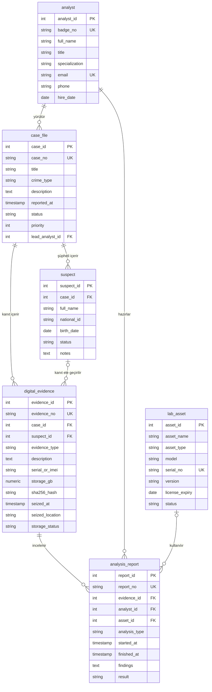

# ER Diyagramı: Adli Bilişim Vaka Takip Sistemi

## Kardinaliteler

| İlişki | Tür |
|---|---|
| analyst → case_file | 1:N |
| case_file → suspect | 1:N |
| case_file → digital_evidence | 1:N |
| suspect → digital_evidence | 1:N (isteğe bağlı) |
| lab_asset → analysis_report | 1:N (isteğe bağlı) |
| **analyst ↔ digital_evidence** | **M:N** (`analysis_report` ara tablosu ile) |
